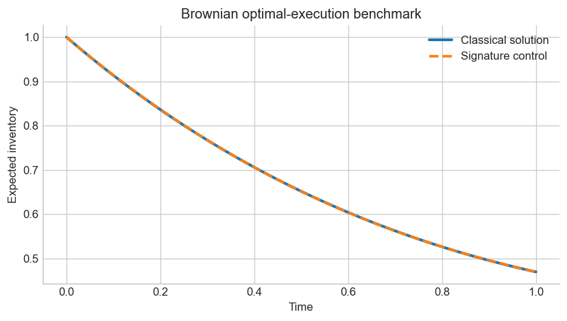
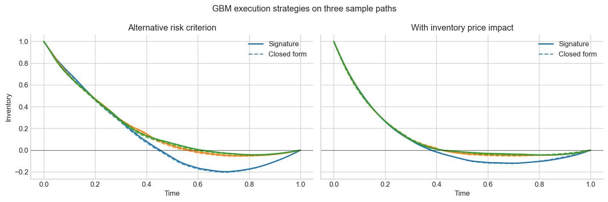

# Signature-Based Optimal Execution

This project studies optimal trade execution when the trading speed is a linear functional of the signature of the observed price path:

$$
\theta_t = \left\langle \ell, \operatorname{Sig}(t, S_t)_{0,t} \right\rangle.
$$

The main contribution is a small symbolic algebra layer that builds the execution objective directly from shuffle products and tensor concatenation. The resulting objective is quadratic in the strategy coefficients, so it can be optimized after explicitly checking convexity or concavity.



At signature level 4, the expected inventory differs from the classical Brownian benchmark by at most $6.2\times10^{-4}$ for the parameters used in the notebook.

## What the project demonstrates

- A custom `SigPoly` implementation for shuffle multiplication, word concatenation, and signature evaluation.
- A Brownian benchmark against the classical optimal-inventory solution.
- A minimum-energy liquidation check with a known closed form.
- Geometric Brownian motion experiments for an alternative risk criterion and an inventory price-impact extension.
- Numerical safeguards that reject saddle points instead of reporting every stationary point as an optimum.



## Mathematical idea

For the time-augmented price path $\widehat S_t=(t,S_t)$, choose a control

$$
\theta_t=\langle\ell,\operatorname{Sig}(\widehat S)_{0,t}\rangle.
$$

The shuffle identity turns products of controls into linear evaluations on the signature, while concatenation with the time letter represents integration in time. Inventory, trading costs, risk penalties, and terminal liquidation terms can therefore be assembled as one signature functional. Pairing it with an exact or empirical expected signature produces a finite-dimensional polynomial in $\ell$.

The notebook focuses on quadratic criteria. The helper module verifies the Hessian curvature before solving the first-order condition and supports a small ridge for numerically flat signature directions.

## Repository layout

```text
.
├── README.md
├── requirements.txt
├── LICENSE
├── figures/
├── notebooks/
│   └── optimal_execution.ipynb
├── src/
│   └── signature_tools.py
└── tests/
    └── test_signature_tools.py
```

Start with [`notebooks/optimal_execution.ipynb`](notebooks/optimal_execution.ipynb) for the mathematical narrative and experiments. The reusable algebra is in [`src/signature_tools.py`](src/signature_tools.py).

## Run locally

Python 3.10 or newer is recommended.

```bash
python -m venv .venv
source .venv/bin/activate  # Windows PowerShell: .\.venv\Scripts\Activate.ps1
python -m pip install --upgrade pip
python -m pip install -r requirements.txt
python -m jupyter lab notebooks/optimal_execution.ipynb
```

Run the notebook from top to bottom. It uses a fixed simulation seed and writes the three summary plots to `figures/`.

To run the tests:

```bash
python -m pytest
```

## Numerical scope

The Brownian examples use Fawcett's exact expected signature of the time-augmented process. The geometric Brownian examples estimate expected signatures by Monte Carlo. Their results therefore depend on the signature truncation level, sample size, finite terminal penalty, and small numerical ridge. The notebook states these approximations rather than treating them as exact identities.

## References

- Jasdeep Kalsi, Terry Lyons, and Imanol Pérez Arribas, [Optimal Execution with Rough Path Signatures](https://arxiv.org/abs/1905.00728).
- Jim Gatheral and Alexander Schied, [Optimal Trade Execution under Geometric Brownian Motion in the Almgren and Chriss Framework](https://doi.org/10.1142/S0219024910005982).
